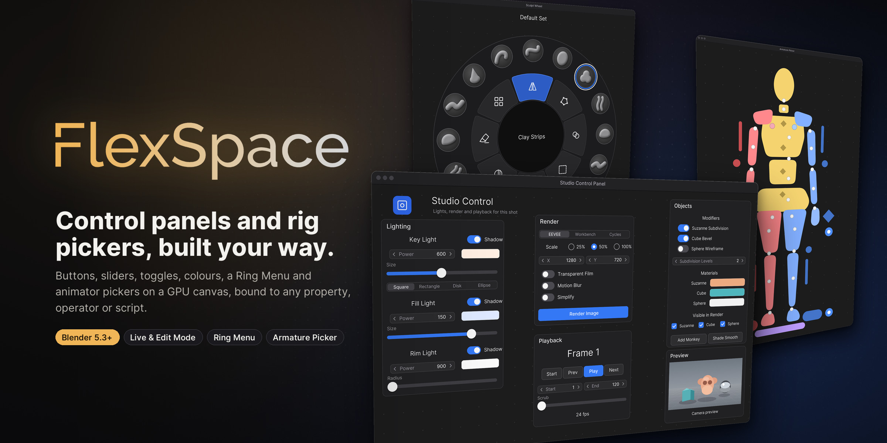
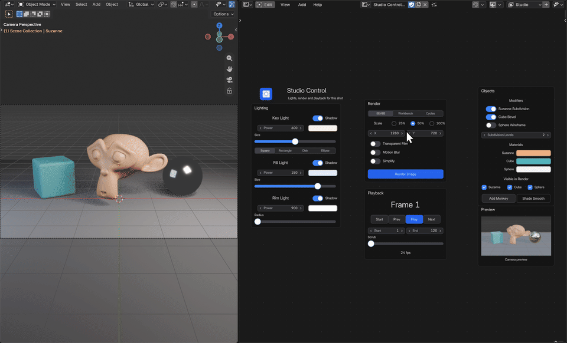
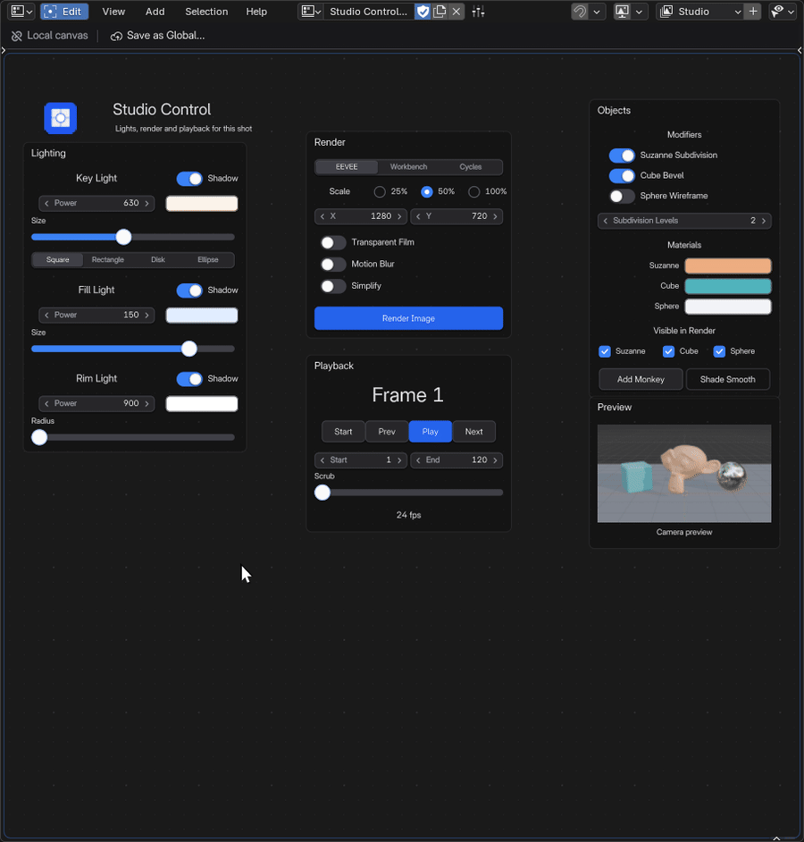
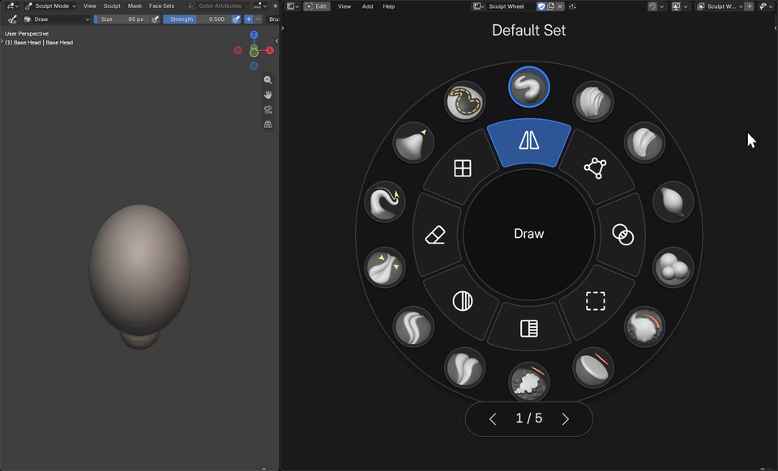
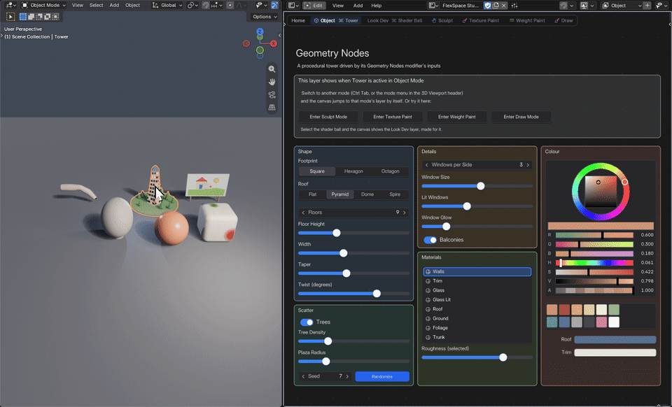

  

  <b>Control panels and rig pickers for Blender, built your way.</b> 
  Buttons, sliders, toggles, colour pickers and a Ring Menu on a GPU canvas, bound to any property, operator or script. 
  Plus an Armature Picker for any rig.

  
  
  

  
  
  

---

## Quick links

| | |
| --- | --- |
| 🛒 **Store** | [FlexSpace & Armature Picker on Superhive](https://superhivemarket.com/products/flexspace-armature-picker) |
| 🌐 **Website** | [jfranmatheu.github.io/flexspace](https://jfranmatheu.github.io/flexspace/) |
| 📖 **Documentation** | [Getting started](https://jfranmatheu.github.io/flexspace/docs/getting-started.html) · [Widgets](https://jfranmatheu.github.io/flexspace/docs/widgets.html) · [Binding](https://jfranmatheu.github.io/flexspace/docs/binding.html) · [Picker](https://jfranmatheu.github.io/flexspace/docs/picker.html) · [Shortcuts](https://jfranmatheu.github.io/flexspace/docs/shortcuts.html) |
| 🐞 **Report a bug** | [Open an issue](../../issues/new/choose) · [FlexSpace form](../../issues/new?template=flexspace.yml) · [Armature Picker form](../../issues/new?template=armature_picker.yml) |
| 🧰 **Troubleshooting** | [Common problems and fixes](https://jfranmatheu.github.io/flexspace/docs/troubleshooting.html) |
| 📝 **What's new** | [Changelog](CHANGELOG.md) |

---

## See it in Blender

<table>
  <tr>
    <td width="50%"></td>
    <td width="50%"></td>
  </tr>
  <tr>
    <td><b>Your panel drives the scene.</b> In Live Mode every toggle, field and slider changes it right away.</td>
    <td><b>Add any widget in seconds.</b> Shift A, type a few letters, pick a card and place it.</td>
  </tr>
  <tr>
    <td></td>
    <td></td>
  </tr>
  <tr>
    <td><b>A Ring Menu for sculpting.</b> Brushes on the outer ring, toggles and operators on the inner one.</td>
    <td><b>One canvas, a page per mode.</b> Enter Sculpt, Texture Paint or Draw and the canvas follows.</td>
  </tr>
</table>

## Two add-ons, one base

**FlexSpace** turns a Node Editor into your own control canvas. Place buttons, toggles, sliders, number fields, colour swatches and pickers, lists, labels, images, frames and Flex Boxes; bind them to any property, operator or script; lay them out with snapping, alignment and groups; give each Blender mode its own page; share canvases as global presets or `.flexspace` files.

**Armature Picker** gives animators one-click pickers for any rig: bone buttons and custom shapes, IK/FK switches, knobs and 2D pads (with a gaze control for the eyes), bone collection toggles and left/right mirroring. With Rigify, a full Humanoid Body picker (body, hands, feet and face over character art) is one step.

Both require **Blender 5.3 or newer**, and both can be installed at the same time.

Built and refined by an independent developer, [J. Fran Matheu](https://x.com/jfranmatheu), since 2023: the [first public preview](https://x.com/jfranmatheu/status/1717207033701617889) of the picker's interactive editing went up on X in October 2023.

## Reporting a bug

The fastest way is from Blender itself:

1. Open **Help > Report a Bug...** in the canvas header (or **Report a Bug** in the add-on preferences).
2. It opens a new issue here with your add-on and Blender versions, your system and the recent errors already filled in.
3. Add what you did and what you expected, then submit.

You can also [open an issue by hand](../../issues/new/choose) and pick the form of your add-on. If you bought it on [Superhive](https://superhivemarket.com/products/flexspace-armature-picker), you can report problems there too.

> **Before reporting:** the [troubleshooting guide](https://jfranmatheu.github.io/flexspace/docs/troubleshooting.html) covers the most common questions.

## About this repository

This is the public home of FlexSpace and Armature Picker: the [website and documentation](https://jfranmatheu.github.io/flexspace/) (served from [`docs/`](docs/)), the [changelog](CHANGELOG.md) and the issue tracker. The add-ons themselves are sold on [Superhive](https://superhivemarket.com/products/flexspace-armature-picker).
